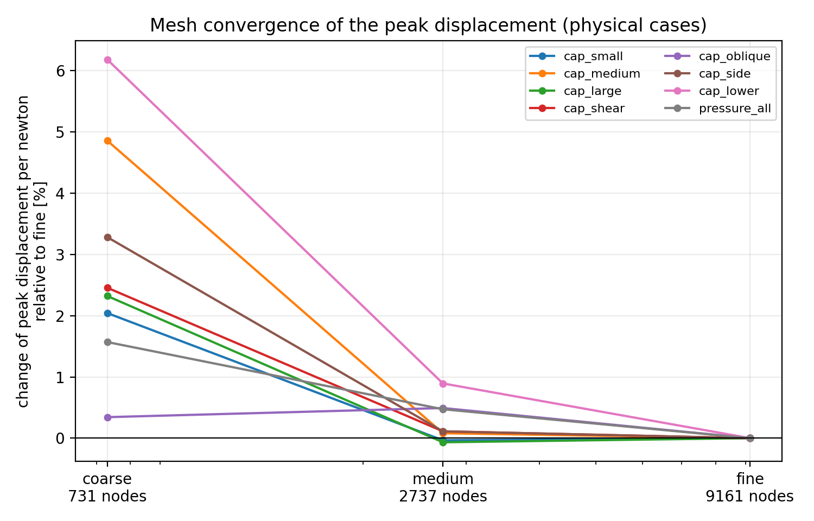
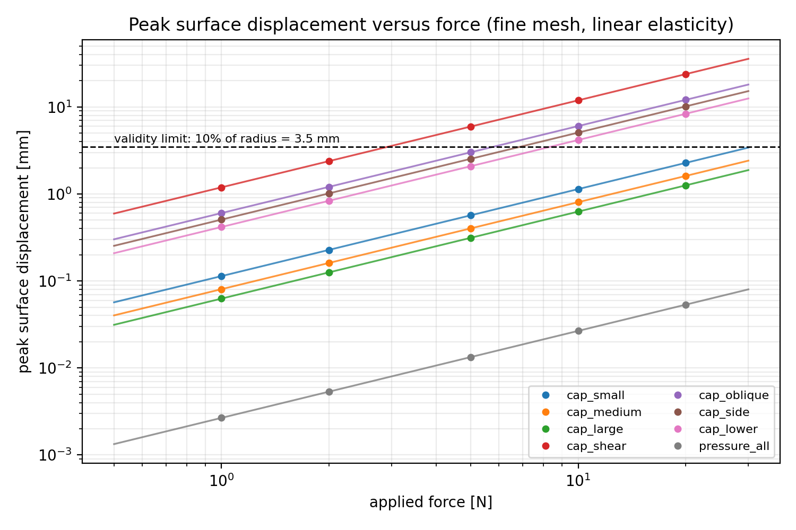
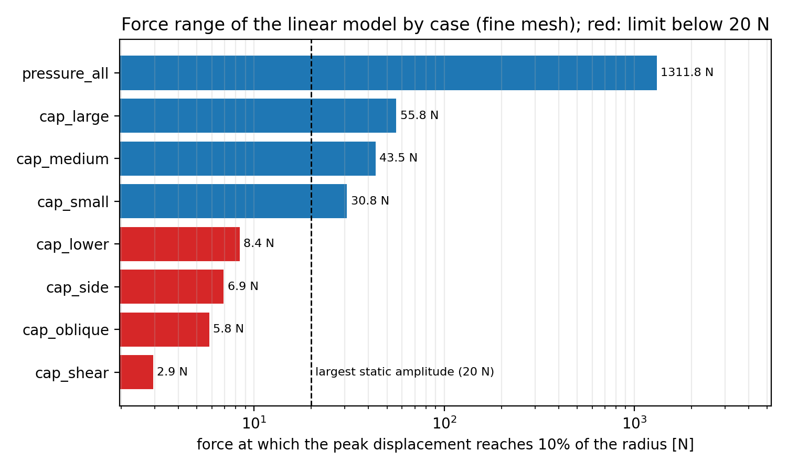
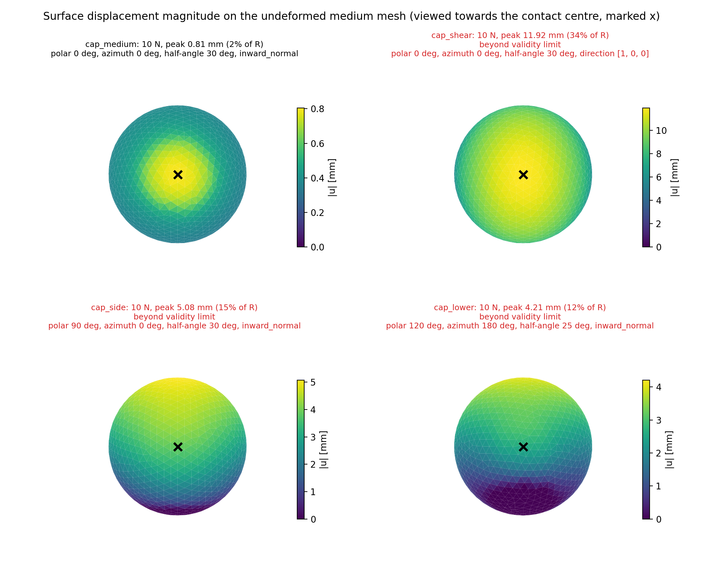
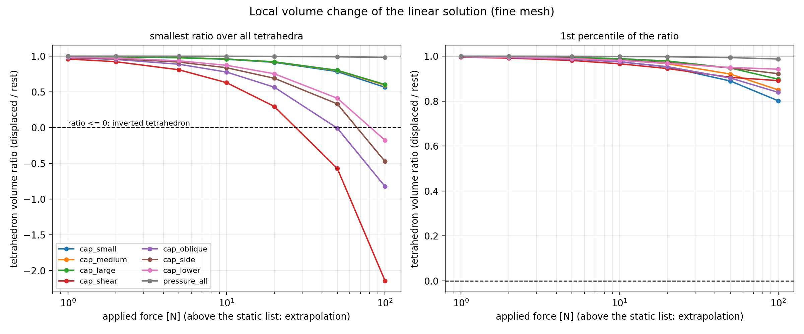

# DeformGrip

Real-time 3D finite element simulation of deformable objects for force-guided hand rehabilitation.

A soft elastic ball deforms in real time under arbitrary 3D surface forces. Rather than solving a finite-element linear system every frame, the linear elastic boundary-value problem is solved offline in Python (`scikit-fem`) to precompute a surface influence matrix $G$, and the Godot 4 (.NET / C#) runtime evaluates surface displacements each frame as a weighted sum of columns of $G$.

The authoritative shared specification is in [CONTRACT.md](CONTRACT.md).

---

## 1. Methodology

### 1.1 Physical Domain, Mesh Discretization, and Load Cases

The simulated object is a homogeneous, isotropic solid sphere $\Omega \subset \mathbb{R}^3$ of radius $R = 0.035\text{ m}$ ($35\text{ mm}$) centered at the origin, with its polar axis along $+z$ ([config/test_settings.json](config/test_settings.json)):

- **Fixed boundary ($\Gamma_D$):** nodes within a $30^\circ$ polar cap around $-z$ are clamped ($\mathbf{u} = \mathbf{0}$) to prevent rigid-body translation and rotation.
- **Loaded / free boundary ($\Gamma_N = \partial\Omega \setminus \Gamma_D$):** arbitrary 3D nodal force vectors are applied on the remaining surface.
- **Mesh hierarchy (`P1` linear tetrahedra):**

| Level | Total Nodes | Tetrahedra | Surface Nodes ($n_{\text{surface}}$) | Fixed Cap Nodes |
|---|---:|---:|---:|---:|
| `coarse` | 731 | 2,853 | 456 | 29 |
| `medium` | 2,737 | 12,448 | 1,220 | 85 |
| `fine` | 9,161 | 45,366 | 2,977 | 200 |

- **Test load cases:** 8 physical distributed-load cases (`cap_small`, `cap_medium`, `cap_large`, `cap_shear`, `cap_oblique`, `cap_side`, `cap_lower`, `pressure_all`) and 2 non-physical random load distributions (`random_a`, `random_b`), each normalized so the sum of nodal force norms equals $1\text{ N}$ and scaled over $0\text{–}20\text{ N}$.

---

### 1.2 Governing PDE, Constitutive Law, and Precomputed Influence Matrix

In Stage 1 (`stage2.enabled = false`), the ball is governed by **static small-strain 3D linear elasticity** (Navier–Cauchy equilibrium) with zero body forces ($\mathbf{f}_b = \mathbf{0}$, gravity disabled):

$$
-\nabla \cdot \boldsymbol{\sigma}(\mathbf{u}) = \mathbf{0} \quad \text{in } \Omega
$$

$$
\mathbf{u} = \mathbf{0} \quad \text{on } \Gamma_D, \qquad \boldsymbol{\sigma}(\mathbf{u})\,\mathbf{n} = \mathbf{t} \quad \text{on } \Gamma_N
$$

Under small-strain kinematics and isotropic Hooke's law, the linearized strain tensor $\boldsymbol{\varepsilon}$ and Cauchy stress tensor $\boldsymbol{\sigma}$ are:

$$
\boldsymbol{\varepsilon}(\mathbf{u}) = \frac{1}{2}\left(\nabla\mathbf{u} + (\nabla\mathbf{u})^T\right), \qquad \boldsymbol{\sigma}(\mathbf{u}) = 2\mu\,\boldsymbol{\varepsilon}(\mathbf{u}) + \lambda\,\operatorname{tr}(\boldsymbol{\varepsilon}(\mathbf{u}))\,\mathbf{I}
$$

where the first and second **Lamé parameters** $(\lambda, \mu)$ are determined from the instantaneous Young's modulus $E_0 = E_\infty + E_1$ and Poisson's ratio $\nu$:

$$
\lambda = \frac{E_0\,\nu}{(1 + \nu)(1 - 2\nu)} \approx 432.10\text{ kPa}, \qquad \mu = \frac{E_0}{2(1 + \nu)} \approx 185.19\text{ kPa}
$$

#### PDE Parameters and Symbols

| Symbol | Value / Definition | Physical Meaning |
|---|---|---|
| $\mathbf{u}(\mathbf{x}) \in \mathbb{R}^3$ | Unknown field $[\text{m}]$ | 3D displacement vector at material point $\mathbf{x} \in \Omega$ |
| $\boldsymbol{\varepsilon}(\mathbf{u})$ | $\frac{1}{2}(\nabla\mathbf{u} + (\nabla\mathbf{u})^T)$ | Linearized Cauchy small-strain tensor (dimensionless) |
| $\boldsymbol{\sigma}(\mathbf{u})$ | $2\mu\,\boldsymbol{\varepsilon} + \lambda\,\operatorname{tr}(\boldsymbol{\varepsilon})\,\mathbf{I}$ $[\text{Pa}]$ | Cauchy stress tensor |
| $E_0$ | $E_\infty + E_1 = 300\text{ kPa} + 200\text{ kPa} = 500\text{ kPa}$ | Instantaneous Young's modulus (representative value, not fitted rubber data) |
| $\nu$ | $0.35$ | Poisson's ratio (governs lateral expansion / compressibility) |
| $\lambda$ | $432.10\text{ kPa}$ | First Lamé parameter (volumetric stiffness contribution) |
| $\mu$ | $185.19\text{ kPa}$ | Second Lamé parameter / shear modulus |
| $\mathbf{f}_b$ | $\mathbf{0}$ | Volumetric body force (gravity is omitted per contract) |
| $\mathbf{n}$ | Unit vector on $\partial\Omega$ | Outward surface normal |
| $\mathbf{t}$ | Surface traction $[\text{Pa}]$ | Applied external contact force density (discretized as nodal loads $\mathbf{F}_s$) |
| $\Gamma_D$ | $30^\circ$ cap at $-z$ | Homogeneous Dirichlet boundary (zero displacement) |
| $\Gamma_N$ | $\partial\Omega \setminus \Gamma_D$ | Neumann boundary where surface forces act |

#### Weak Form and Finite-Element Discretization

Multiplying the equilibrium PDE by a test function $\mathbf{v} \in H^1_{\Gamma_D}(\Omega)^3$ and integrating by parts yields the variational (weak) form implemented in [solver/fem_core.py](solver/fem_core.py):

$$
\int_\Omega \boldsymbol{\sigma}(\mathbf{u}) : \boldsymbol{\varepsilon}(\mathbf{v})\,d\Omega = \int_{\Gamma_N} \mathbf{t} \cdot \mathbf{v}\,d\Gamma \qquad \forall\,\mathbf{v} \in H^1_{\Gamma_D}(\Omega)^3
$$

Discretizing $\Omega$ with piecewise-linear vector tetrahedral elements (`ElementVector(ElementTetP1())` in `scikit-fem`) produces a sparse symmetric positive-definite system in node-major interleaved coordinates $(x, y, z)$. Removing the fixed-cap DOFs (`fixed_nodes`) gives the reduced system:

$$
K_{\text{free}}\,\mathbf{u}_{\text{free}} = \mathbf{F}_{\text{free}}
$$

which is factorized once per mesh level via sparse LU (`scipy.sparse.linalg.splu`).

#### Surface Influence Matrix $G$ (Discrete Green's Function)

Because the PDE and boundary conditions are linear, the surface displacement $\mathbf{u}_s \in \mathbb{R}^{3 n_{\text{surface}}}$ is a linear map of the surface nodal force vector $\mathbf{F}_s \in \mathbb{R}^{3 n_{\text{surface}}}$:

$$
\mathbf{u}_s = G\,\mathbf{F}_s
$$

Each column $3j + b$ ($b \in \{0, 1, 2\}$) of the $(3 n_{\text{surface}}) \times (3 n_{\text{surface}})$ symmetric **influence matrix** $G$ is obtained offline by one back-substitution for a unit $1\text{ N}$ load along axis $b$ at surface row $j$ (columns and rows belonging to fixed-cap nodes are zero). [solver/export.py](solver/export.py) streams $G$ block-by-block in `float64` and exports it as column-major little-endian `float32` (`solver/export/<level>/G.bin`).

---

### 1.3 Real-Time Godot / C# Runtime

At runtime, no matrix assembly or linear solve occurs ([core/src/InfluenceMatrix.cs](core/src/InfluenceMatrix.cs), [godot/Scripts/Scene/BallMeshView.cs](godot/Scripts/Scene/BallMeshView.cs), [godot/Scripts/Scene/MainController.cs](godot/Scripts/Scene/MainController.cs)):

1. **Force evaluation:** `CaseForceSource` (implementing the open `IForceInput` interface) scales the sparse case pattern into active `NodalLoad(row, fx, fy, fz)` entries from either the manual slider ($0\text{–}20\text{ N}$) or a CSV force profile (`slow_squeeze`, `rapid_press`).
2. **Column accumulation:** `InfluenceMatrix.Apply` skips zero force components and accumulates $\mathbf{u}_s = \sum f_{j,b}\,G_{:,3j+b}$ using SIMD (`System.Numerics.Vector<float>`) into preallocated buffers (zero per-frame heap allocations).
3. **Coordinate mapping & GPU upload:** displacements are transformed from contract coordinates $(x, y, z)$ to Godot Y-up coordinates $(x, z, -y)$, optionally scaled by a display-only visual gain ($\times 1$ default, up to $\times 50$), area-weighted smooth normals are recomputed, and the GPU vertex buffer is updated in-place via `RenderingServer.MeshSurfaceUpdateVertexRegion` (with `OctahedralU16` normal packing).
4. **Stage 2 / SOFA hooks:** `ViscoelasticState` supports optional Prony-series relaxation stepping at `dt_force_s = 0.001 s`, and `SofaPlaybackRunner` provides side-by-side linear playback when SOFA force tables are present.

---

### 1.4 Validity and Geometric Distortion Checks

- **Small-strain validity flag:** Linear elasticity assumes infinitesimal strains. Whenever true physical peak displacement exceeds `validity.max_disp_fraction_of_radius * R` ($0.10 \times 35\text{ mm} = 3.50\text{ mm}$), Godot displays a high-contrast HUD warning banner and analysis tables flag `beyond_validity = true`.
- **Element volume ratio:** [solver/volume_check.py](solver/volume_check.py) evaluates deformed-to-rest volume ratios across every tetrahedron from $1\text{ N}$ up to $100\text{ N}$ (a ratio $\le 0$ marks an inverted tetrahedron).

---

## 2. Main Results and Findings

### 2.1 Mesh Convergence

Peak displacement per newton ($\text{mm/N}$) and relative change against the `fine` mesh ([results/ours/analysis/mesh_convergence.csv](results/ours/analysis/mesh_convergence.csv), [fig3_mesh_convergence.png](results/ours/analysis/fig3_mesh_convergence.png)):

| Case | `coarse` ($\text{mm/N}$) | `medium` ($\text{mm/N}$) | `fine` ($\text{mm/N}$) | `coarse` vs `fine` | `medium` vs `fine` |
|---|---:|---:|---:|---:|---:|
| `cap_small` | 0.1160 | 0.1136 | 0.1137 | +2.04% | -0.03% |
| `cap_medium` | 0.0843 | 0.0805 | 0.0804 | +4.86% | +0.08% |
| `cap_large` | 0.0641 | 0.0626 | 0.0627 | +2.32% | -0.07% |
| `cap_shear` | 1.2200 | 1.1921 | 1.1908 | +2.46% | +0.11% |
| `cap_oblique` | 0.6047 | 0.6056 | 0.6027 | +0.34% | +0.49% |
| `cap_side` | 0.5237 | 0.5076 | 0.5070 | +3.28% | +0.11% |
| `cap_lower` | 0.4428 | 0.4207 | 0.4170 | +6.18% | +0.89% |
| `pressure_all` | 0.00271 | 0.00268 | 0.00267 | +1.57% | +0.47% |

**Finding:** The `medium` mesh (1,220 surface nodes) agrees with `fine` (2,977 surface nodes) within **$< 0.9\%$** across all 8 physical cases (and within $\le 0.11\%$ on `cap_small`, `cap_medium`, `cap_large`, `cap_shear`, and `cap_side`), whereas `coarse` deviates by up to $+6.18\%$ (`cap_lower`).



---

### 2.2 Displacement Response, Small-Strain Validity, and Element Distortion

From [results/ours/analysis/validity_limits.csv](results/ours/analysis/validity_limits.csv), [results/ours/analysis/static_summary.csv](results/ours/analysis/static_summary.csv), and [results/ours/analysis/volume_ratio.csv](results/ours/analysis/volume_ratio.csv):

| Case | Validity Limit Force on `fine` ($10\%$ of $R = 3.5\text{ mm}$) | Peak Disp at $20\text{ N}$ on `fine` | `%` of $R$ at $20\text{ N}$ (`fine`) | Min Tet Volume Ratio at $20\text{ N}$ (`fine`) |
|---|---:|---:|---:|---:|
| `cap_small` | 30.79 N | 2.27 mm | 6.50% | 0.914 |
| `cap_medium` | 43.51 N | 1.61 mm | 4.60% | 0.920 |
| `cap_large` | 55.85 N | 1.25 mm | 3.58% | 0.922 |
| `cap_shear` | **2.94 N** | 23.82 mm | **68.04%** | 0.297 |
| `cap_oblique` | **5.81 N** | 12.05 mm | **34.44%** | 0.566 |
| `cap_side` | **6.90 N** | 10.14 mm | **28.97%** | 0.691 |
| `cap_lower` | **8.39 N** | 8.34 mm | **23.83%** | 0.754 |
| `pressure_all` | 1,311.83 N | 0.053 mm | 0.15% | 0.997 |

**Findings:**
- **Axial compression vs. lateral/shear compliance:** Axial caps (`cap_small`, `cap_medium`, `cap_large`) and uniform pressure (`pressure_all`) stay well inside the $10\%$ small-strain range throughout $0\text{–}20\text{ N}$. Tangential, oblique, lateral, and lower-cap loads are substantially more compliant and cross the $3.5\text{ mm}$ validity threshold at **$2.94\text{ N}$** (`cap_shear`), **$5.81\text{ N}$** (`cap_oblique`), **$6.90\text{ N}$** (`cap_side`), and **$8.39\text{ N}$** (`cap_lower`).
- **Mesh quality under deformation:** Within the $0\text{–}20\text{ N}$ operating range, **zero inverted tetrahedra** occur on any mesh level (`n_inverted_tets = 0`), though severe shear at $20\text{ N}$ compresses local elements down to a volume ratio of `0.297` on `fine`. Element inversion under the unclipped linear model appears only under extrapolated forces $\ge 50\text{ N}$ (e.g., `cap_shear` produces 7 inverted tetrahedra at $50\text{ N}$ and 47 at $100\text{ N}$ on `fine`).

#### Analysis Figures

| Peak Displacement vs. Force | Small-Strain Validity Limits |
|---|---|
|  |  |
| **Surface Displacement Maps (`medium`, $10\text{ N}$)** | **Tetrahedral Volume Ratio ($1\text{–}100\text{ N}$)** |
|  |  |

---

### 2.3 Runtime and Benchmark Performance

Measured across offline Python ([results/ours/timing/](results/ours/timing)) and the exported Windows Desktop Godot release build with VSync off ([results/godot/timing/](results/godot/timing), `slow_squeeze` replay, 60-frame warmup excluded; GPU: NVIDIA GeForce RTX 3050 6GB Laptop GPU, CPU: 12th Gen Intel Core i5-12450HX):

| Level | `G.bin` Size | Offline Precompute | Case (Nonzero Load DOFs) | Python Full FEM Solve (mean) | Python Cached LU (mean / p95) | Godot C# Core `Apply` (mean / p95) | Godot Whole Frame (mean / p95 / max) | 60 FPS Target (`p95 <= 16.7 ms`) |
|---|---:|---:|---|---:|---:|---:|---:|---|
| `coarse` | 7.1 MiB | 2.26 s | `cap_medium` (93) | 451.26 ms | 1.26 / 1.63 ms | 0.076 / 0.122 ms | 0.648 / 0.912 / 27.959 ms | **PASS** |
| `coarse` | 7.1 MiB | 2.26 s | `pressure_all` (1,368) | 391.64 ms | 1.05 / 1.39 ms | 0.830 / 1.571 ms | 1.603 / 2.720 / 5.649 ms | **PASS** |
| `medium` | 51.1 MiB | 21.06 s | `cap_medium` (258) | 2,838.76 ms | 10.67 / 20.80 ms | 0.479 / 0.777 ms | 1.158 / 1.633 / 4.489 ms | **PASS** |
| `medium` | 51.1 MiB | 21.06 s | `pressure_all` (3,660) | 2,727.30 ms | 8.88 / 10.59 ms | 3.035 / 8.976 ms | 3.891 / 10.133 / 20.549 ms | **PASS** |
| `fine` | 304.3 MiB | 409.06 s | `cap_medium` (609) | 27,699.40 ms | 78.72 / 101.24 ms | 1.818 / 3.813 ms | 2.685 / 5.020 / 11.395 ms | **PASS** |
| `fine` | 304.3 MiB | 409.06 s | `pressure_all` (8,931) | 27,484.48 ms | 67.04 / 85.72 ms | 5.237 / 48.640 ms | 6.098 / 49.917 / 79.845 ms | **OVER BUDGET** |

**Findings:**
- **Speedup from precomputation:** For localized contact (`cap_medium`), Godot whole-frame p95 stays at **$0.91\text{ ms}$** (`coarse`), **$1.63\text{ ms}$** (`medium`), and **$5.02\text{ ms}$** (`fine`) — well under the $16.7\text{ ms}$ ($60\text{ FPS}$) frame budget, compared to $2.84\text{–}27.70\text{ s}$ for an uncached FEM solve or $20.8\text{–}101.2\text{ ms}$ p95 for cached sparse LU back-substitution.
- **Practical sweet spot (`medium`):** Combining the mesh convergence and timing results, `medium` achieves $< 0.9\%$ spatial agreement with `fine`, keeps `G.bin` at $51.1\text{ MiB}$, builds in $21.1\text{ s}$, and stays under the $16.7\text{ ms}$ p95 frame budget even when **every surface node** is loaded (`pressure_all`: $10.13\text{ ms}$ p95).
- **Precomputation trade-off:** Because $G$ scales as $O(n_{\text{surface}}^2)$, `fine` `pressure_all` (all 8,931 surface load components nonzero simultaneously) streams the entire $304.3\text{ MiB}$ matrix each frame, causing tail spikes (`p95 = 49.92 ms`). Additionally, SOFA reference outputs (`results/sofa/`) and `compare/out/` are not yet populated in the repository, so cross-solver accuracy (`ours` vs. SOFA) is pending SOFA data.

---

## 3. Repository Layout

```text
CONTRACT.md                    shared specification (authoritative)
config/                [Role 4]   settings, force profiles, test cases
model/                 [Role 1a]  ball meshes + surface data        -> model/README.md
solver/                [Role 2a, 2b] Python solver, export, benchmark -> solver/README.md
  export/                         influence matrices (regenerated, not committed)
core/                  [Role 2b]  plain C# library used by the scene
sofa/                  [Role 3]   SOFA reference                    -> sofa/README.md
godot/                 [Role 1b]  Godot 4 .NET scene                -> godot/README.md
results/                          outputs, one subfolder per source
compare/               [Role 4]   comparison, figures, report text  -> compare/README.md
```

### Roles & Data Flow

| Role | Workspace | Brief |
|---|---|---|
| 1a Model | `model/` | [model/README.md](model/README.md) |
| 1b Scene | `godot/`, `results/godot/` | [godot/README.md](godot/README.md) |
| 2a Solver | `solver/` (solver files), `results/ours/static`, `results/ours/dynamic` | [solver/README.md](solver/README.md) |
| 2b Export + core | `solver/` (export files), `core/`, `results/ours/timing` | [solver/README.md](solver/README.md) |
| 3 SOFA | `sofa/`, `results/sofa/`, `results/sofa_large/` | [sofa/README.md](sofa/README.md) |
| 4 Comparison | `config/`, `compare/` | [compare/README.md](compare/README.md) |

| Producer | Output | Consumers |
|---|---|---|
| 4 | `config/test_settings.json`, `config/profiles/`, `config/cases/` | all |
| 1a | `model/<level>/ball.msh`, `surface.json` | 2a, 2b, 3, 1b, 4 |
| 2a | `results/ours/static/*`, `solver/fem_core.py` | 2b, 3 (self-check), 4 |
| 2b | `solver/export/<level>/G.bin`, `core/`, `results/ours/timing/*` | 1b, 4 |
| 3 | `results/sofa/*`, `results/sofa_large/*` | 1b (playback), 4 |
| 1b | `results/godot/timing/*`, `results/godot/dumps/*` | 2b (parity), 4 |
| 4 | `compare/out/*` | report |

---

## 4. How to Run the Project

Requirements: Python with `pip install -r solver/requirements.txt`, the .NET 8 SDK, and the Godot version pinned in `godot/VERSION.txt` (.NET edition). `godot/DeformGrip.csproj` builds against the real core (`UseCoreStub` is false).

1. **Influence matrices** (not in git, 7 / 51 / 304 MiB; the fine level takes several minutes):
   ```powershell
   python solver/export.py
   ```
2. **C# core against Python:**
   ```powershell
   python solver/check_parity.py
   ```
   (part 1; it stops with a clear message if a `G.bin` is missing).
3. **Godot dumps** (run from the repository root; `godot` is your Godot .NET executable):
   ```powershell
   godot --headless --path godot -- --dump coarse cap_medium slow_squeeze
   godot --headless --path godot -- --dump medium cap_medium slow_squeeze
   godot --headless --path godot -- --dump fine cap_shear rapid_press
   godot --headless --path godot -- --dump medium pressure_all slow_squeeze
   ```
   Each writes `results/godot/dumps/ours_<level>_<case>_<profile>.bin` (4 to 29 MB; commit only a few). Then run `python solver/check_parity.py` again; part 2 compares the dumps with Python.
4. **Look at the scene** in the Godot editor (`F5`, or `godot --path godot`): the ball must not be inside-out or mirrored, and its polar axis must be vertical. Try a case and an amplitude, and check the validity warning with `cap_shear` at 5 N or more.
5. **Timing** needs an exported build with VSync off (the editor is allowed but is labelled `"editor"`). In Godot: **Project > Export**, choose `"Windows Desktop"` or `"Linux x86_64"` (export templates for your Godot version must be installed, and `godot/build/` must exist when exporting via CLI), export a release build to `godot/build/`, then run the executable with `-- --benchmark` (on Windows use the `.console.exe` to see the output):
   ```powershell
   godot --headless --path godot --export-release "Windows Desktop"
   godot\build\DeformGrip.console.exe -- --benchmark
   ```
   It writes `results/godot/timing/<level>_<case>.json` for each timing case.

### Working rules

- Write only inside what you own (CONTRACT 2). To request a change in someone else's output, ask the user to relay it.
- `CONTRACT.md` changes only through the user.
- A change to `config/test_settings.json` after M1 invalidates other roles' results and must be announced.
- `solver/export/<level>/G.bin` is not in git. Generate it with `python solver/export.py` before running the Godot scene.
- Result files other than `G.bin` are committed, so that `compare/compare.py` runs from a clean checkout.
